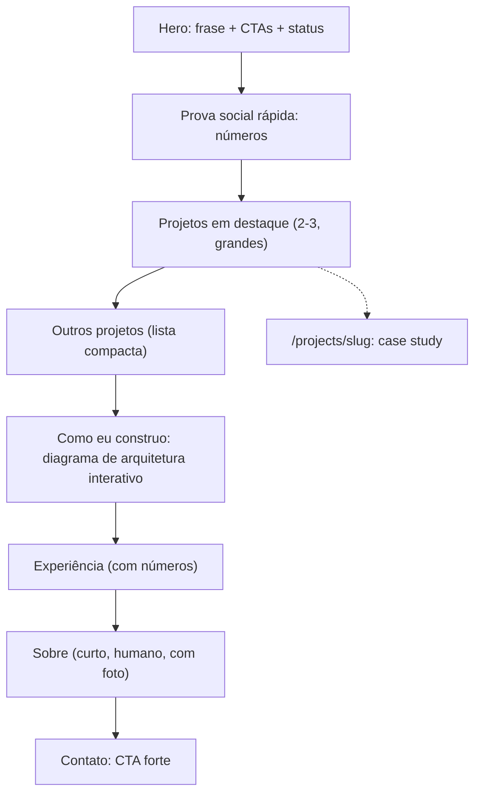
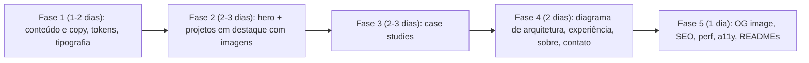

# Spec: redesign do portfolio (de "CV digital" para portfolio)

> **Objetivo:** fazer com que, em **até 30 segundos**, um recrutador (técnico ou de RH) saiba **quem é você, o que você constrói e por que deveria te chamar**, e lembre do site depois.

---

## 0. Diagnóstico atual

| Problema | Onde está | Efeito no recrutador |
|---|---|---|
| A estrutura é a mesma de um currículo (`Hero → Whoami → Projects → Skills → Experience → Contact`) | [page.tsx](file:///home/fqls/Desenvolvimento/Portfolio/app/[locale]/page.tsx) | "Já vi isso, é um CV" |
| Tudo é texto, sem nenhuma imagem de projeto | [projects.tsx](file:///home/fqls/Desenvolvimento/Portfolio/components/sections/projects.tsx) | Não dá para avaliar a qualidade visual do trabalho |
| Os 5 projetos têm o mesmo peso (grid de 3 colunas e mesmo `WindowFrame`) | `projects.tsx` | O olho não sabe para onde ir |
| Uma única fonte (JetBrains Mono) em tudo | [DESIGN.md](file:///home/fqls/Desenvolvimento/Portfolio/DESIGN.md) | Pouca hierarquia, cansa ler |
| Neon `#39ff14` usado em muitos lugares | tokens `primary-container` | Perde força como destaque |
| Os efeitos (glitch, decrypt, letter-glitch) são só decoração | `components/*` | Custo de performance sem mostrar competência |
| Posicionamento inconsistente (Go aparece em um texto e some em outro; 13 tecnologias listadas) | `messages/*.json`, `data/profile.ts` | Parece generalista sem foco |
| Experiência sem números | [experience.ts](file:///home/fqls/Desenvolvimento/Portfolio/data/experience.ts) | Não mostra impacto |
| O README do repo ainda é o padrão do `create-next-app` | `README.md` | Recrutador técnico abre o repo e vê descuido |

---

## 1. Princípios de design

1. **Mostrar em vez de listar.** Toda afirmação ("sei arquitetura", "sei mobile") precisa de uma prova visual: imagem, diagrama ou número.
2. **Hierarquia brutal.** Uma coisa principal por tela. Projetos em destaque grandes, o resto pequeno.
3. **O terminal é tempero, não prato.** A identidade "kernel/dev" continua nos detalhes (paths, prompts, cursor, easter eggs), mas a leitura principal é a de um site editorial moderno.
4. **Escaneável em 2 níveis.** Quem lê só os títulos e números já entende tudo. Quem quiser profundidade entra nos case studies.
5. **Rápido e acessível.** LCP < 2,0s, nada piscando sem `prefers-reduced-motion` e contraste AA.

---

## 2. Direção visual

### 2.1 Conceito: "Kernel Editorial"
Mistura de **revista técnica** (tipografia grande, muito respiro, imagens fortes) com **detalhes de sistema** (labels mono, grid visível, status de processo e cursor piscando). Referências para pesquisar: brittanychiang.com (estrutura), rauno.me (detalhe e motion), linear.app (tipografia e escuro elegante), vercel.com/design (grid e mono como acento) e o site do Bun ou do Railway (estética dev sem cair no clichê de terminal).

### 2.2 Tipografia

| Papel | Fonte | Tamanho desktop / mobile | Peso | Uso |
|---|---|---|---|---|
| Display (hero) | **Space Grotesk**, ou Geist / Inter Tight | `clamp(48px, 8vw, 104px)` | 600–700, tracking `-0.04em` | Uma frase por página |
| H2 (seção) | mesma sans | `clamp(32px, 4vw, 56px)` | 600 | Títulos de seção |
| H3 (projeto) | mesma sans | 28–36px / 22px | 600 | Nome do projeto |
| Corpo | **Inter** ou Geist | 17–18px, line-height 1,6, máx. 65ch | 400 | Textos |
| Mono (acento) | **JetBrains Mono** (já usa) | 12–14px, uppercase, tracking `0.08em` | 500 | Labels, paths, chips, metadados |

- Carregar via `next/font` com `display: swap` e subset `latin`.
- **Regra:** mono nunca em parágrafo longo.
- Os títulos de seção podem ter um prefixo mono pequeno acima, como eyebrow: `01 — ~/projects`, e o título grande sans embaixo: "Projetos selecionados".

### 2.3 Cores
Manter a base escura e reduzir o neon a **acento raro**.

| Token | Valor sugerido | Uso |
|---|---|---|
| `bg` | `#0B0D0B` | Fundo principal |
| `bg-alt` | `#111411` | Seções alternadas (dá ritmo) |
| `surface` | `#161A16` | Cards |
| `border` | `#232823` | Bordas 1px |
| `text` | `#EDEFEA` | Texto principal |
| `text-muted` | `#9AA396` | Texto secundário (checar AA em 16px) |
| `accent` | `#39FF14` | **No máximo 1–2 usos por tela**: cursor, CTA principal, um número em destaque |
| `accent-soft` | `rgba(57,255,20,0.08)` | Glow de fundo e hover |
| `amber` | `#FFBA43` (já existe) | Status "em produção" e avisos |

- Gradiente radial sutil atrás do hero: `radial-gradient(600px at 70% 20%, rgba(57,255,20,.08), transparent)`.
- Textura opcional: grid de 1px com 4% de opacidade ou noise SVG com 3%, no lugar do `letter-glitch` em tela cheia.

### 2.4 Grid e espaçamento
- Container de 1200px, 12 colunas, gutter de 24px.
- Escala de espaçamento 4/8/12/16/24/32/48/64/96/128.
- **Entre seções: 128–160px no desktop e 80px no mobile** (hoje são 64–96px, o que deixa as seções coladas).
- Quebrar o grid de propósito: imagens de projeto podem "sangrar" uma coluna para fora do container.

### 2.5 Componentes base
- **Botão primário:** fundo `accent`, texto `#051a00`, raio de 6px, padding `12px 20px`, ícone de seta que anda 4px no hover.
- **Botão secundário:** borda de 1px, texto `text`, hover com `accent-soft`.
- **Chip de tech:** mono de 12px, borda de 1px e fundo transparente. **No máximo 5 por projeto** (hoje o TrackIt tem 9).
- **Card:** raio de 12px, borda de 1px. No hover, a borda passa para `accent` com 40% e o card sobe 4px (`translateY`). Nada de sombra pesada.
- **Eyebrow:** `● 01 / PROJETOS` em mono de 12px, com o ponto na cor `accent`.

### 2.6 Motion
- Biblioteca: `motion`, que já está instalada.
- **Entrada:** fade + translateY(16px), 400ms, `ease-out`, com stagger de 60ms. Uma vez só (`once: true`).
- **Hero:** palavras do título entram em sequência e o cursor `▍` pisca no fim.
- **Projetos:** leve parallax da imagem (±20px) no scroll, usando CSS scroll-driven animations (`animation-timeline: view()`) com fallback.
- **Proibido:** glitch em texto que precisa ser lido, efeitos contínuos em tela cheia, animação em toda seção.
- Tudo envolto em `@media (prefers-reduced-motion: no-preference)`.

---

## 3. Nova arquitetura de informação



Páginas:
- `/[locale]`: home
- `/[locale]/projects/[slug]`: case study (TrackIt, Memedio e VT Shield primeiro)
- `/[locale]/cv`: versão HTML do currículo, imprimível, ao lado do PDF
- `/[locale]/uses` (opcional, mostra personalidade): setup, distro Linux, editor

---

## 4. Seções, uma a uma

### 4.1 Navbar
- Fixa, com 64px de altura, fundo `bg` com 70% de opacidade e `backdrop-filter: blur(12px)`, e borda inferior de 1px quando o scroll passa de 0.
- Esquerda: logo `fs_` em mono com o `_` piscando.
- Centro (desktop): Projetos · Arquitetura · Experiência · Sobre. Use **nomes humanos**: `~/projects.sh` confunde quem é de RH, então o path mono fica só como tooltip ou easter egg.
- Direita: toggle PT/EN e o botão **"Currículo ↓"** (secundário, sempre visível).
- Mobile: menu em sheet de tela cheia com links grandes (32px).
- Indicador da seção ativa: um sublinhado de 2px na cor `accent`.

### 4.2 Hero (a dobra mais importante)
**Layout desktop:** 7 colunas de texto e 5 colunas com o elemento visual. Altura de `min(100svh, 860px)`.

**Conteúdo:**
```
● disponível para novas oportunidades — Backend / Fullstack         (mono 12px, ponto verde pulsando)

Construo backends que
aguentam produção.▍                                                   (display 96px)

Desenvolvedor Backend/Fullstack em Node.js, NestJS e Go.
Hoje mantenho sistemas e infraestrutura em produção na Skypass.      (corpo 20px, muted)

[ Ver projetos → ]   [ Baixar CV ↓ ]   GitHub · LinkedIn               (CTAs)
```

**Elemento visual (direita), com 3 opções em ordem de preferência:**
1. **Terminal interativo compacto** (reaproveita o [terminal.tsx](file:///home/fqls/Desenvolvimento/Portfolio/components/terminal.tsx)): janela de 420×320 já "rodando" `$ curl api.felipe.dev/status`, que devolve um JSON bonito com stack, local e disponibilidade. Quem quiser digita comandos. **É um bônus, não a navegação principal.**
2. Retrato ASCII ([ascii-portrait.tsx](file:///home/fqls/Desenvolvimento/Portfolio/components/ascii-portrait.tsx)) que vira a **foto real** no hover. Gera conexão humana e mantém a identidade.
3. Mini-diagrama animado de requisição (cliente → API → DB) com pacotes de luz percorrendo as linhas.

**Mobile:** texto primeiro, CTAs ocupando a largura toda e o terminal embaixo, menor e não interativo.

**Remover do hero:** `letter-glitch` em tela cheia e textos com efeito decrypt no título.

### 4.3 Faixa de números (prova rápida)
Logo abaixo do hero, uma linha de 3–4 métricas em destaque:

| `5+` | `3` | `1` | `100%` |
|---|---|---|---|
| projetos entregues | plataformas (web, mobile, API) | sistema em produção mantido | offline-first no Memedio |

- Número em display de 48px, label em mono de 12px muted.
- Animação de contagem ao entrar na tela (só se `reduced-motion` estiver desligado).
- ⚠️ **Use só números reais.** Melhor ainda se vierem da Skypass (usuários, uptime, tickets, deploys).

### 4.4 Projetos em destaque (o coração do site)
**2–3 projetos, um por "tela"**, alternando a posição da imagem (zig-zag).

**Layout de cada projeto (desktop):**
```
┌──────────────────────────────────────────────────────────────┐
│  01 / FULLSTACK · 2025                         (eyebrow mono) │
│                                                              │
│  ┌────────────────────────────┐   TrackIt                    │
│  │                            │   Rastreabilidade e auditoria │
│  │   MOCKUP: dashboard web    │   de entregas, do motorista   │
│  │   + celular sobreposto     │   ao gestor.                  │
│  │   (7 colunas)              │                               │
│  │                            │   Problema → 1 frase          │
│  └────────────────────────────┘   Solução  → 1 frase          │
│                                   Destaque → 1 número/fato    │
│                                                              │
│                                   [NestJS] [Next.js] [RN]     │
│                                   [MySQL] [Maps API]          │
│                                                              │
│                                   Ver case study →  Código ↗  │
└──────────────────────────────────────────────────────────────┘
```

**Detalhes:**
- **Imagem:** mockup com moldura de browser/celular sobre um fundo `surface` com glow `accent-soft`. Formato 16:10, `next/image` com `priority` só no primeiro projeto e `sizes` correto.
- **Vídeo opcional:** loop mudo de 6–10s (MP4/WebM, < 1,5MB) que toca no hover ou quando entra na tela, com poster estático.
- **Hover na imagem:** scale de 1,02 e a borda vira `accent`.
- **Texto:** no máximo 3 linhas de "problema/solução/destaque". Os bullets técnicos atuais vão para o case study.
- **Ordem sugerida:**
  1. **TrackIt**: o mais completo (API + web + mobile), mostra visão fullstack.
  2. **Memedio**: mobile, offline-first, problema humano fácil de entender.
  3. **VT Shield**: segurança, extensão de navegador, demo rápida.

**Assets necessários (você precisa produzir):**
- [ ] TrackIt: 1 print do dashboard, 1 print do app, 1 GIF do fluxo de entrega e o diagrama de arquitetura
- [ ] Memedio: 3 prints do app (lista, agendamento, estoque) e mockup de celular
- [ ] VT Shield: print do popup com resultado e GIF da análise de URL
- Ferramentas: **shots.so** ou **Screely** (mockups), **Excalidraw/tldraw** (diagramas), **Kap/Peek** (GIF no Linux)

### 4.5 Outros projetos (lista compacta)
VehiGo, Skypass features e futuros projetos em formato de **lista tipo índice**, não de cards:

```
VehiGo                     Descrição curta em uma linha         TS · Node     2025   ↗
Skypass — módulos          Features em sistema de produção      PHP · MySQL   2025   🔒
```
- Linha inteira clicável. No hover, o fundo vira `accent-soft` e aparece uma miniatura flutuante da imagem que segue o cursor (só no desktop).
- 🔒 para projetos privados, com tooltip "código proprietário".

### 4.6 Case study (`/projects/[slug]`)
É o que mais diferencia portfolio de CV. Template:

1. **Header:** título grande, frase de 1 linha e metadados em mono (papel · período · stack · links).
2. **Imagem hero** de largura total.
3. **Contexto/problema:** 1 parágrafo.
4. **Meu papel:** "desenvolvimento individual: backend, web, mobile e modelagem".
5. **Arquitetura:** diagrama (Mermaid renderizado ou SVG do Excalidraw) e a explicação de cada parte.
6. **Decisões técnicas** em formato "Decisão → Por quê → Trade-off". Ex.: *"fetch nativo em vez de axios → menos dependências → perdi interceptors, resolvi com wrapper"*. **Recrutador técnico adora isso.**
7. **Telas:** galeria com legenda.
8. **Desafios e como resolvi.**
9. **Resultados e aprendizados.**
10. **Próximos passos.**
11. Navegação: ← projeto anterior · próximo projeto →

Implementação: conteúdo em MDX (`@next/mdx`) ou em objetos dentro de `data/projects.ts`, com `generateStaticParams`. **Antes, ler os docs de MDX e de rotas dinâmicas em `node_modules/next/dist/docs/`** (Next 16).

### 4.7 "Como eu construo": arquitetura interativa (substitui a seção Skills)
Em vez de uma matriz de skills, um **diagrama de sistema clicável**:

```
[ Web (Next.js/React/Angular) ]   [ Mobile (React Native/Expo) ]
               \                         /
                ──── [ API (NestJS · Go · PHP) ] ────
                               |
          [ Dados (PostgreSQL · MySQL · Oracle) ]
                               |
          [ Infra (Linux · Docker · Nginx · CI/CD) ]
```
- Cada nó é um botão. Ao clicar, abre um painel lateral com: tecnologias, **em qual projeto usei** (com link) e nível de experiência (texto como "uso diário em produção", **sem barras de %**).
- Linhas animadas com "pacotes" de luz passando (SVG `stroke-dashoffset`).
- Mobile: o diagrama vira um acordeão vertical.
- Ninguém mais tem isso, é memorável e reforça o posicionamento backend.

### 4.8 Experiência
- **Skypass System** em destaque, com cargo, período e **3 conquistas com número**:
  - "Reduzi X…", "Automatizei Y…", "Mantive Z serviços com N% de uptime…"
- Uma frase sobre o contexto da empresa.
- Formação em uma linha discreta abaixo (não precisa de card próprio).
- Visual: timeline vertical simples, com uma linha de 1px e um ponto `accent` no cargo atual. O estilo `git log` pode ficar como detalhe (hash mono pequeno ao lado da data).

### 4.9 Sobre (curto e humano)
- **Foto real** (profissional, mas não engessada) e 3–4 linhas em primeira pessoa: o que te motiva, o que você está estudando agora (Go?) e um detalhe pessoal.
- "Atualmente: estudando Go · lendo *Designing Data-Intensive Applications* · usando Arch/Fedora".
- Humaniza o site, e RH contrata pessoas.

### 4.10 Contato
- Título grande: **"Vamos conversar?"** ou "Bora construir algo?".
- E-mail grande e clicável, com botão de **copiar** (feedback "copiado ✓").
- LinkedIn, GitHub e o botão de CV.
- Status: "Respondo em até 24h · Campo Mourão, PR · aberto a remoto".
- ⚠️ Avaliar se vale **remover o telefone** do site público (spam), deixando-o só no CV.

### 4.11 Footer
- "Feito com Next.js · código no GitHub ↗" (mostra transparência) e a data da última atualização.
- Easter egg: "tente pressionar `~`" abre o terminal em overlay de qualquer página.

---

## 5. O que fazer com os componentes atuais

| Componente | Decisão |
|---|---|
| `terminal.tsx`, `help-panel.tsx` | **Manter** como elemento do hero e overlay com `~` |
| `ascii-portrait.tsx` | **Manter**, com transição para a foto real |
| `window-frame.tsx` | Usar só em mockups e no terminal, **não em todo card** |
| `letter-glitch.tsx`, `background-fx.tsx` | **Remover** ou trocar por grid/noise estático |
| `decrypted-text.tsx`, `fuzzy-text.tsx` | Usar no máximo em 1 lugar (ex.: eyebrow do hero) |
| `type-on-view.tsx` | Só no terminal |
| `sections/skills.tsx` | **Substituir** pela arquitetura interativa |
| `sections/whoami.tsx` | Dividir em "Hero" + "Sobre" |

---

## 6. Conteúdo e copy

- **Posicionamento único** em todo lugar (site, LinkedIn, CV):
  > "Desenvolvedor Backend/Fullstack · Node.js, NestJS e Go · APIs e sistemas em produção"
- Corrigir: *"focado performance"* → "com foco em performance".
- Cortar a lista de 13 tecnologias do intro. Manter **4–5 principais** e deixar o resto no diagrama.
- Cada projeto no formato **Problema → Solução → Resultado**.
- Verbos de ação: *construí, reduzi, automatizei, modelei, entreguei*.
- Versão EN revisada por completo (vagas remotas internacionais).

---

## 7. Performance, acessibilidade e SEO

**Performance**
- LCP < 2,0s, CLS < 0,05, INP < 200ms (medir com Lighthouse e Vercel Speed Insights).
- Imagens em AVIF/WebP via `next/image`, com `sizes` corretos e lazy load abaixo da dobra.
- Componentes pesados (terminal, diagrama) com `dynamic()` e hidratação só quando visíveis.
- Fontes: no máximo 2 famílias, com subset.

**Acessibilidade**
- Contraste AA (atenção ao muted sobre o fundo escuro).
- Foco visível (anel `accent` de 2px, com offset de 2px).
- Diagrama interativo navegável por teclado e com `aria-expanded`.
- `prefers-reduced-motion` respeitado em tudo.
- O terminal sempre tem uma alternativa sem digitação (os chips que já existem).

**SEO e compartilhamento**
- **Imagem OG dinâmica** (`opengraph-image.tsx`) com nome, cargo e visual do site. Ela aparece quando o link é colado no LinkedIn/WhatsApp, e **recrutador vê isso antes de clicar**.
- Metadata por página (case studies com título e descrição próprios).
- JSON-LD `Person` com `sameAs` (GitHub, LinkedIn).
- Domínio próprio (`felipesrutkoske.dev`).

---

## 8. Fora do site (mesmo peso)

- [ ] README do repositório do portfolio (print, stack e decisões)
- [ ] README de cada projeto em destaque, com GIF e diagrama
- [ ] Perfil do GitHub com README e os 4 melhores repositórios fixados
- [ ] LinkedIn com o mesmo título e o link do site na seção "Destaques"
- [ ] CV em PDF alinhado com o site (mesmo posicionamento e números)
- [ ] **Um projeto novo em Go** (API com testes, Docker e GitHub Actions) para sustentar o posicionamento

---

## 9. Roadmap



| Fase | Entregas | Dependência sua |
|---|---|---|
| 1 | Posicionamento, textos PT/EN, novos tokens de cor/fonte | Aprovar a copy e passar números reais |
| 2 | Navbar, hero, faixa de números, vitrine de projetos | **Prints e GIFs dos projetos** |
| 3 | Rota `/projects/[slug]` e 3 case studies | Detalhes de decisões e desafios |
| 4 | Diagrama interativo, experiência, sobre e contato | Foto |
| 5 | OG image, JSON-LD, Lighthouse ≥ 95, READMEs | — |

---

## 10. Checklist do "teste dos 30 segundos"

Peça para 3 pessoas (1 dev, 1 não-dev, 1 recrutador se possível) abrirem o site por 30s e responderem:
1. Qual é a profissão dele?
2. Qual tecnologia ele domina?
3. Qual projeto você lembra?
4. Como você entraria em contato?

Se alguma resposta falhar, a seção correspondente precisa ser revista.

---

## 11. Decisões tomadas ✅

| # | Decisão | Escolha | Motivo |
|---|---|---|---|
| 1 | Fonte display | **Space Grotesk** + Inter (corpo) + JetBrains Mono (acento) | Escolha do Felipe |
| 2 | Elemento do hero | **Terminal compacto "API viva"** | Prova o perfil backend na hora: a janela já abre rodando `$ curl api.felipe.dev/status` e devolve um JSON (`role`, `stack`, `location`, `available: true`, `currently_learning: "Go"`). Reaproveita o `terminal.tsx`, **não depende de foto** e serve de easter egg para dev. O retrato ASCII sai do hero e vai para a seção "Sobre", trocando para foto quando houver |
| 3 | Case studies | **Dados em TypeScript** (estender `data/projects.ts` com o campo `caseStudy`) + rota `/[locale]/projects/[slug]` com `generateStaticParams` | Mantém o padrão atual, sem dependência nova (MDX), com i18n PT/EN no mesmo lugar e tipagem forte |
| 4 | Telefone | **Removido do site**, fica só no CV | Evita spam |
| 5 | Go | **Foco real** → entra no posicionamento e no roadmap um **projeto novo em Go** | Sustenta o título "Node.js, NestJS e Go" |

### Projeto em Go (novo item do roadmap, Fase 6)
Sugestão que conversa com o TrackIt e mostra backend sério:
- **"trackit-events"**: microserviço em Go que recebe eventos de entrega (HTTP/gRPC), persiste no PostgreSQL e expõe métricas.
- Requisitos para impressionar: estrutura `cmd/` + `internal/`, testes (`go test`, tabela de casos), `Dockerfile` multi-stage, `docker-compose`, GitHub Actions (lint + test + build), endpoint `/metrics` (Prometheus), README com diagrama e benchmark simples.
- Vira o 3º ou 4º projeto em destaque no site.

---

## 12. Pendências do Felipe 📌

> Enquanto essas pendências não forem resolvidas, o site usa **placeholders elegantes**: mockup estilizado gerado em código (moldura de browser/celular com UI esquemática em wireframe e cores do tema), o retrato ASCII no lugar da foto e números ocultos até existirem. Nada de "imagem quebrada".

### Imagens e vídeos dos projetos
- [ ] **TrackIt:** prints do dashboard web (tela principal, lista de entregas, detalhe da auditoria), prints do app mobile (rota no mapa, confirmação de entrega) e um GIF de 6–10s do fluxo de entrega
- [ ] **Memedio:** 3 prints do app (lista de medicamentos, agendamento de dose, estoque)
- [ ] **VT Shield:** print do popup com resultado e um GIF analisando uma URL
- [ ] **VehiGo:** 1 print principal (para a miniatura no hover da lista)
- [ ] Diagrama de arquitetura do TrackIt (pode ser feito no Excalidraw. Se preferir, eu monto em Mermaid/SVG a partir do repositório)
- Dicas: prints em resolução de 1440px de largura, com dados fictícios realistas (sem "teste123"); mockups em **shots.so**; GIFs com **Peek** ou **Kap** no Linux, ou gravação de tela convertida com `ffmpeg` para MP4/WebM

### Foto
- [ ] 1 foto sua, de busto, com fundo neutro, boa luz natural, roupa casual-profissional. Celular moderno no modo retrato resolve

### Números reais (Skypass e projetos)
- [ ] Quantos sistemas/serviços você mantém
- [ ] Ganhos mensuráveis: tempo de deploy, incidentes, automações, horas economizadas
- [ ] Usuários/clientes impactados
- [ ] Qualquer métrica de projeto (ex.: nº de endpoints e cobertura de testes do TrackIt)

### Conteúdo dos case studies
- [ ] Para cada projeto em destaque: o problema real, as 2–3 decisões técnicas mais importantes (com o porquê), o maior desafio e o que você faria diferente

### Fora do site
- [ ] Projeto em Go (Fase 6)
- [ ] READMEs dos projetos e o perfil do GitHub
- [ ] Atualizar o título do LinkedIn
- [ ] Revisar o CV em PDF (com telefone e o novo posicionamento)
- [ ] Domínio próprio (opcional): `felipesrutkoske.dev`